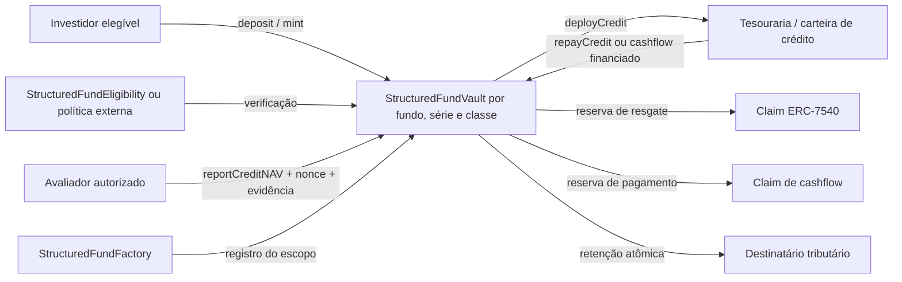

# Arquitetura e modelo econômico

## Fronteiras



O vault representa uma única classe fungível de uma única série. Não há uma posição compartilhada entre classes nem um wrapper com segundo supply. A factory calcula `scopeId = keccak256(abi.encode(chainId, factory, fundId, seriesId, classId))`. O evento de criação permite reconstruir seus componentes. Uma implantação direta pode escolher outro identificador não nulo: integradores devem validar a origem do escopo.

O desenho é uma referência nova, não uma alteração do storage do Diamond nem uma implementação UUPS. Configuração de asset, política, escopo, tesouraria, destinatário de retenção e cap é imutável. Mudanças nessas escolhas exigem nova instância e uma migração explícita.

## Unidades e limites

Todos os valores monetários, inclusive principal e retenção, usam **unidades nativas do asset**. Por exemplo, 25 USDC com seis casas é `25_000_000`. Cotas usam 18 casas. Assets com zero até 18 casas são aceitos; valores maiores são rejeitados no construtor.

O limite de assets por instância é no máximo `2^96 - 1`; o supply máximo é `2^160 - 1`. Esses limites também permitem calcular `maxDeposit` sem overflow, mesmo após uma perda integral de NAV. O cap limita NAV corrente; ele não é um limite cumulativo de captação ou de principal histórico. Produto que precise desses limites deve acrescentá-los explicitamente.

O ERC-4626 OpenZeppelin fornece:

```text
virtualShares = 10^(18 - assetDecimals)
convertToShares(A) = floor(A * (supply + virtualShares) / (NAV + 1))
convertToAssets(S) = floor(S * (NAV + 1) / (supply + virtualShares))
previewMint(S)     = ceil(S * (NAV + 1) / (supply + virtualShares))
```

Esses termos virtuais criam resíduos de arredondamento pequenos e afetam o resultado após perdas e esvaziamento. Principal registra o valor efetivamente aportado, inclusive arredondamento de mint. Não é uma base fiscal por lote nem uma garantia de recuperação. `mint(1)` com USDC recebe um wei de cota e pode custar uma unidade nativa de asset; a diferença de precisão precisa ser apresentada pela interface do produto.

## Contabilidade do NAV e do caixa

```text
NAV = managedCash + creditNAV
saldo do asset >= managedCash + reservedRedemptions + reservedCashflows
```

Na ausência de doações e de tokens que alterem saldos autonomamente, a segunda expressão é uma igualdade. Doações diretas são excluídas do NAV e dos limites de liquidez; não existe função de sweep. Não devem ser usadas para financiar uma obrigação operacional. Assets com taxas, rebasing ou saldo manipulável são incompatíveis com o modelo; tokens bloqueáveis podem impedir saídas mesmo depois de reservas corretamente constituídas.

| Operação | Caixa gerido | NAV de crédito | Reservas |
| --- | --- | --- | --- |
| Deposit/mint de A | +A | — | — |
| DeployCredit de A | −A | +A | — |
| RepayCredit de A | +A | −A | — |
| ReportCreditNAV | — | valor declarado | — |
| Fulfillment de resgate por A | −A | — | resgate +A |
| Claim de resgate | — | — | resgate −A |
| Cashflow P + Y − W, baixa de NAV R | — | −R | pagamento +(P + Y − W) |
| Claim de cashflow | — | — | pagamento −líquido |

`deployCredit` envia somente caixa gerido à tesouraria imutável. `repayCredit` recebe dinheiro on-chain exato e troca NAV de crédito por caixa. Não é uma contabilização automática de cada contrato de recebível.

`reportCreditNAV` atualiza apenas o crédito, com nonce sequencial e evidence hash não nulo. Não pode superar o cap junto com caixa gerido, nem criar crédito em uma instância sem supply. Pode declarar valorização, perda ou um crédito incorreto se o avaliador for comprometido. A política de avaliação, os recebíveis existentes e seus controles precisam ser verificados fora do contrato de referência.

## Principal e transferências

`principalOf(account)` contém principal associado às cotas livres. Em transferência de S cotas de uma carteira com B cotas, move-se `floor(principal * S / B)`; na transferência integral move-se todo o principal, evitando um saldo sem cotas. Auto-transferência não altera o principal.

Uma solicitação de resgate captura o principal proporcional e o move para o estado do controlador, separado do principal livre. Isso impede que duas solicitações de investidores diferentes em custódia misturem seus valores de principal. `lockedPrincipalOf(controller)` soma o principal pending e o principal de cancelamento claimable.

```text
totalOutstandingPrincipal = soma do principal livre + totalLockedPrincipal
principal captado = principal outstanding + principal amortizado + principal aposentado em resgates
```

O principal é aposentado no fulfillment do resgate, quando as cotas são queimadas, ainda que o pagamento final seja menor por perda ou maior por rendimento. Aposentadoria de principal não significa que aquele valor foi devolvido. O evento `PrincipalRetired` permite distinguir essa extinção econômica de uma amortização efetivamente financiada.

## Resgate assíncrono

Todos os requests usam id zero, agregado por controlador. O dono autoriza um terceiro por allowance ERC-20 **ou** operador; operador não precisa de allowance. O dono pode atribuir o controle a outra carteira elegível. Isso transfere deliberadamente poder de claim e cancelamento ao controlador.

1. `requestRedeem` transfere cotas para escrow e captura principal; supply permanece emitido.
2. `fulfillRedeem` processa todo o pending daquele controlador pela taxa atual, exige caixa, queima cotas, aposenta principal e reserva assets.
3. `redeem` ou `withdraw` consome a obrigação, com autorização do controlador ou operador e destinatário elegível.

Pending e claimable podem coexistir. Fulfillments sucessivos acumulam shares e assets claimable num pool do controlador; os claims usam a proporção desse pool. Claim por shares arredonda assets para baixo; o último claim recebe o restante. Claim por assets arredonda shares para cima. Um withdraw parcial que consumiria todas as shares por arredondamento é rejeitado; o integrador deve usar redeem integral para encerrar direitos de poeira. Perda integral permite redeem de cotas claimable com zero assets.

Os previews de redeem/withdraw sempre revertem conforme o fluxo assíncrono. `maxRedeem` e `maxWithdraw` mostram direitos claimable e retornam zero se pausado ou se o controlador perdeu elegibilidade.

## Cancelamento

Cancelamento afeta somente pending, bloqueia novas solicitações para o controlador e bloqueia o fulfillment daquele pending. O settler transforma o cancelamento em claimable; o controlador ou operador faz o claim para uma carteira elegível. As cotas não são enviadas automaticamente. O principal capturado é restaurado junto com as cotas, sem reprecificação.

Cancelamentos e seus claims continuam disponíveis durante uma pausa, mas o claim ainda verifica elegibilidade. Não há mecanismo que burle congelamento ou permita ao administrador recuperar compulsoriamente uma carteira; essa necessidade institucional exige uma extensão cuidadosamente revisada.

## Cashflows

O settler registra uma obrigação individual completamente financiada: principal P, rendimento bruto Y e retenção W, com `W <= Y`. O vault recebe `P + Y`, transfere W ao destinatário tributário e reserva `P + Y - W`. Principal é reduzido no registro, não novamente no claim. A amortização exige principal livre do beneficiário e NAV de crédito suficientes; não pode consumir principal em escrow de resgate.

O terceiro parâmetro de `recordCashflow`, `navRelease = R`, indica quanto daquele pagamento já estava reconhecido no NAV de crédito. Exige-se `P <= R <= P + Y` e `R <= creditNAV`. R=P para rendimento ainda não reconhecido; R=P+Y quando todo o rendimento já estava no NAV; valores intermediários representam reconhecimento parcial. O evento `CashflowNAVReleased` registra essa baixa. Exemplo: crédito 105 com principal 100 e yield já reconhecido 5; pagamento P=20/Y=5/W=1 baixa R=25, deixando NAV e principal 80 e reserva líquida 24. Baixar só P nesse caso contaria os mesmos 5 como NAV e pagamento. A exatidão de R é uma afirmação contábil do settler, não uma inferência automática do contrato.

Amortização não queima cotas: elas continuam representando a fração do patrimônio restante, cujo NAV é reduzido por R. Direitos já registrados ficam associados ao beneficiário original após uma transferência de cotas. Cada período individual é fechado e não pode se sobrepor ao anterior; pagamentos de um mesmo período para o mesmo beneficiário precisam ser consolidados em um único registro.

Não há cálculo automático de juros, pro rata, waterfall ou snapshot global. O settler atesta a alocação. O financiamento e os limites são verificáveis; a justiça da alocação e a autenticidade da evidência continuam sendo hipóteses explícitas de confiança.

## Distribuição conjunta

A referência oferece registro atômico de até 64 cashflows. Esse limite controla o trabalho máximo por chamada; cada beneficiário continua fazendo seu próprio claim. O contrato garante atomicidade financeira, mas não calcula a lista de beneficiários nem a proporcionalidade. Posições pending continuam no supply até o fulfillment: sua participação econômica nos cupons deve ser reconciliada pela política do produto antes de registrar distribuições.

A factory cria um `StructuredFundVaultDeployer` imutável em seu construtor. Somente essa factory pode chamá-lo. O contrato auxiliar contém o bytecode de criação do vault; separar isso do controle de papéis evita exceder o limite de runtime. Um deploy inválido reverte sem consumir o escopo no registry.

A criação usa CREATE2. A factory calcula o endereço a partir do mesmo bytecode e configuração usados pelo deployer, registra-o antes da criação e retorna o endereço efetivamente criado. O registro é utilizável após a transação concluir; qualquer falha do construtor desfaz a reserva. O método de criação tem proteção contra reentrância.
