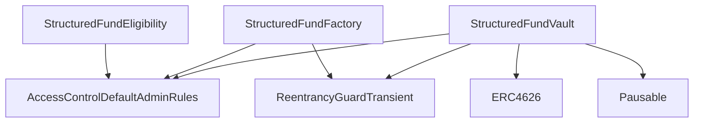
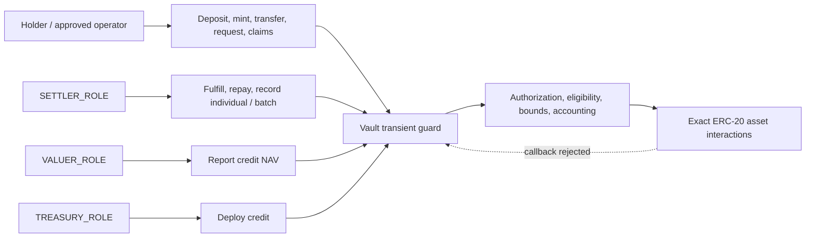
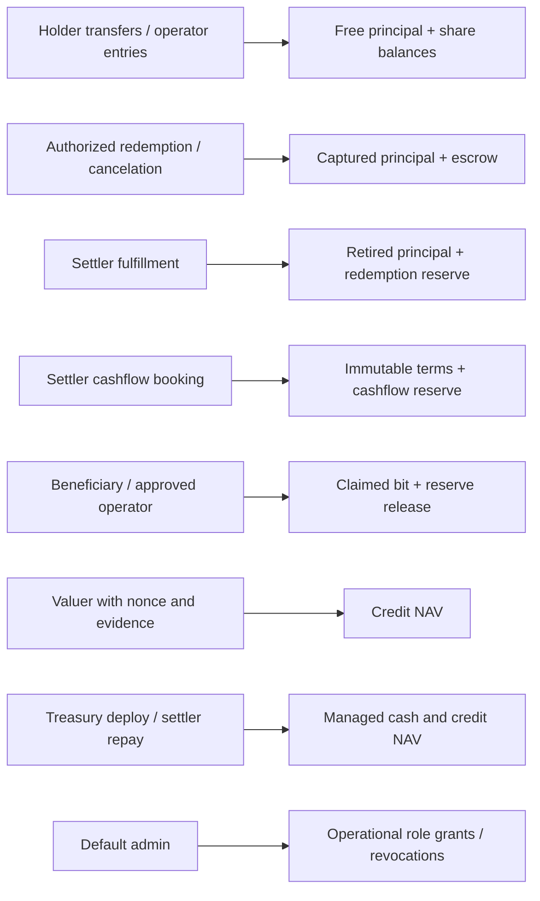

# Security diagrams

Generated from Slither 0.11.6 inheritance, function-summary and vars-and-auth printers. The role grouping below is reviewed against the source: an empty printer column is not proof of missing access control. Full own-contract tables are in [the model](../reports/security-model.json).

## Inheritance

The vault and factory both inherit ReentrancyGuardTransient. Eligibility and the factory-bound deployer do not expose a mutable financial ledger. The production contracts contain no proxy, initializer or upgrade entry point.

## Entry points and boundaries

Twenty financial entry points (including the slippage wrapper) are exercised by the callback matrix. Pausing, role administration, operator approval and ERC-20 allowance approval retain their own authorization rules. Views stay readable during callbacks; they are not an atomic cross-protocol price oracle.

## State and authorization

The admin can change role holders; the two-day default-admin transfer delay does not timelock operational role grants. Cashflow allocation, NAV and off-chain evidence remain trusted assertions. The seven stateful properties reconcile principal, reserves, supply, NAV, immutable terms and limits after handler actions.
